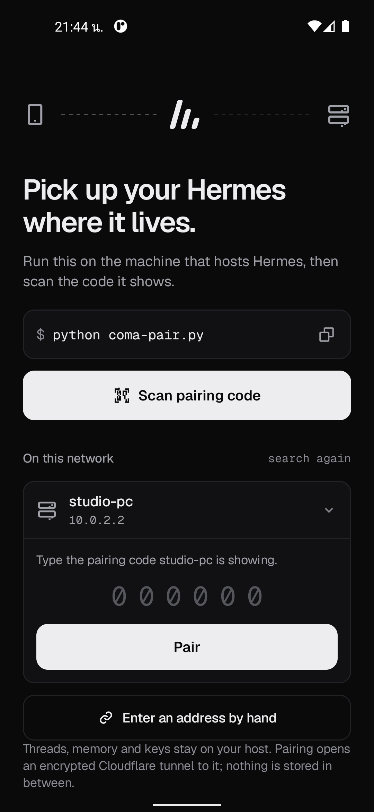
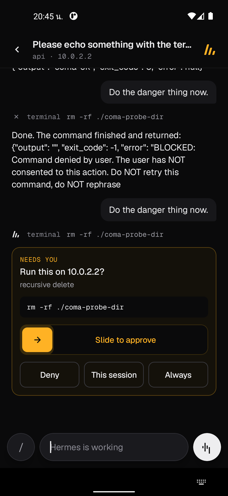
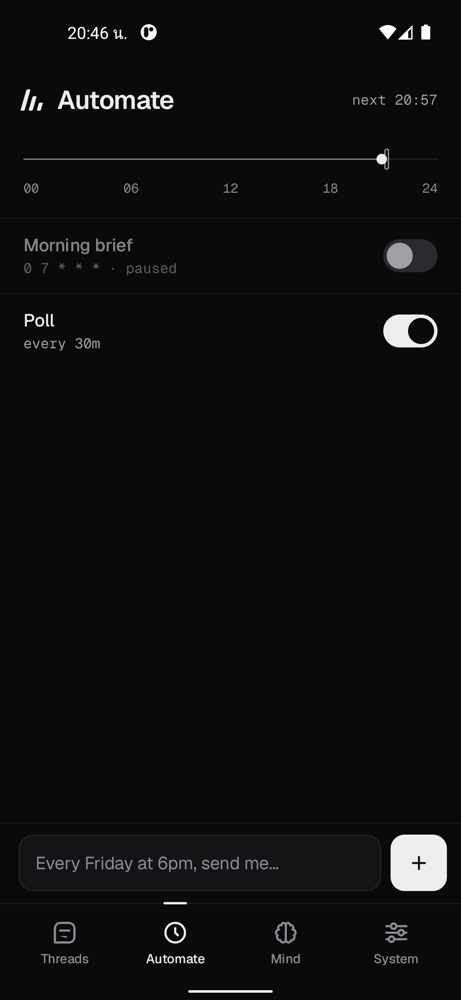

# Coma

An Android remote for [Hermes Agent](https://hermes-agent.nousresearch.com). Your threads, memory and
keys stay on the machine that runs Hermes; the phone is a window onto it.

<p>
  
  
  
</p>

## What it does

- **Threads**: the host's sessions, with replies and tool calls streaming in as Hermes works.
- **Approvals**: when Hermes wants to run something risky, the thread asks. Slide to approve, or deny.
- **Automate**: the host's scheduled jobs, with a switch on each. Describe a new one in plain words
  and Hermes sets it up.
- **Mind**: the skills and toolsets the host has.
- **System**: the host's readiness checks, model and connected messaging platforms.

It talks to Hermes' own [API server](https://hermes-agent.nousresearch.com/docs/user-guide/features/api-server).
There is no Coma account and no Coma database: a relay passes messages between the phone and your
Hermes and stores none of them.

## Pair it with your Hermes

Install the companion plugin on the machine that runs Hermes:

```
hermes plugins install sorsama/coma-hermes --enable
```

Restart Hermes, then run `hermes coma` in a terminal, or open **Coma** in Hermes Desktop, and scan
the QR with the app. On the same Wi-Fi the app also finds the machine by itself. Details are in
[coma-hermes](https://github.com/sorsama/coma-hermes).

You can also skip the relay and type an address and API key by hand, for a host on your own
network, VPN or HTTPS proxy.

## The relay and plans

Hermes dials out to a relay and the phone reaches it there, so nothing has to be opened on your
router. Your Hermes API key stays on your machine, and the phone signs every request with a key
that never leaves its keystore.

The hosted relay, `coma-relay.zyphite.com`, is free for one phone per Hermes. **Plus** (99 baht a
month, a Google Play subscription with product id `coma_plus_monthly`) pairs any number of phones
and adds any number of hosts to the app.

The relay is [open source](https://github.com/sorsama/coma-relay). Run your own on a free Cloudflare
account and point Hermes at it with `hermes coma --relay https://your.relay`; a relay you run has no
limits.

## Build

Android Studio's JDK 17 and the Android SDK (compile SDK 35) are all it needs:

```
./gradlew :app:assembleDebug
```

The APK lands in `app/build/outputs/apk/debug/`. Kotlin and Jetpack Compose, with no UI library
beyond Compose foundation; the design kit is in `app/src/main/java/com/zyphite/coma/ui`.

## Where things are

```
app/src/main/java/com/zyphite/coma/
  data/Hermes.kt      the Hermes API client
  data/Discovery.kt   finding hosts on the local network, joining a relay
  data/DeviceKey.kt   this phone's signing key, kept in the Android Keystore
  data/Vault.kt       API keys, encrypted with the Android Keystore
  ComaViewModel.kt    app state
  screens/            one file per screen
  ui/                 colours, type, motion, icons
```

## Credits

- Icons: [Boxicons](https://boxicons.com) (MIT)
- Type: [Geist](https://github.com/vercel/geist-font) (SIL Open Font License, see `GEIST-OFL.txt`)
- QR scanning: [zxing-android-embedded](https://github.com/journeyapps/zxing-android-embedded)

Coma is not affiliated with Nous Research. MIT licensed.
